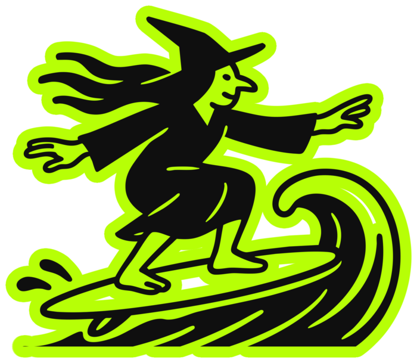
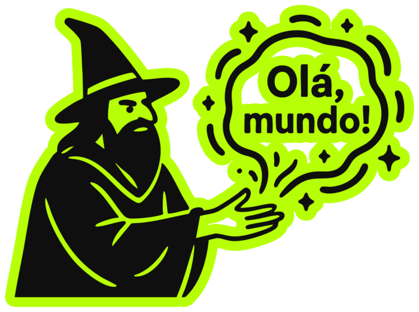
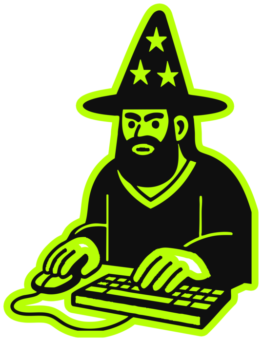
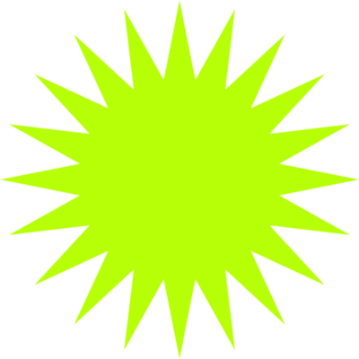
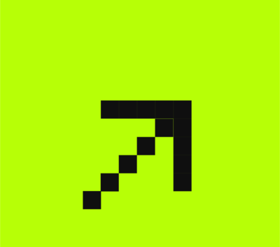
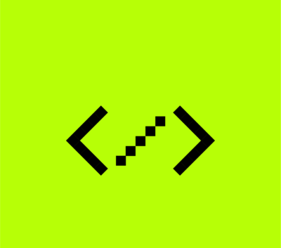

<!-- _class: figurinhas -->
<!-- _paginate: false -->
<!-- _footer: "" -->

## Figurinhas

### Dazumbanho! Chegasse ao fim, ixtepô!

    

 olha aqui <mark>marca-texto</mark>  

Identidade visual de Ana Terhorst, [anaterhorstdesign.com](https://anaterhorstdesign.com). Valeu, Ana!

<!--
- Copie a linha da figurinha para o seu slide; o número em w:190 define a largura em pixels.
- A figurinha marca-texto é um realce: troque a palavra dela, ou use <mark>palavra</mark> numa palavra sua. O círculo pixelado é palavra.
- Uma figurinha por slide costuma bastar.
-->
